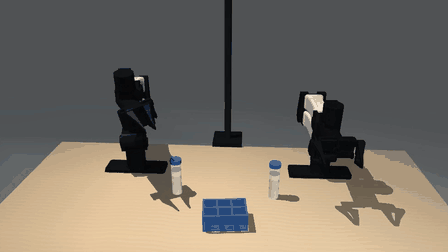
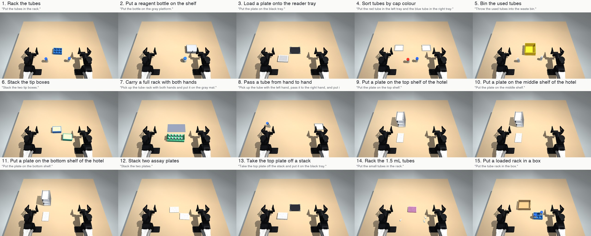
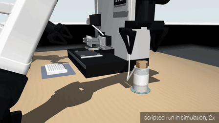

# robot-lab-handling

**Status: simulation only.** 19 tasks so far: the first 15 everyday lab handling tasks, and 4 instrument tending
tasks around a plate dispenser. Their scoring is checked by scripts. The set is meant to grow.
Dream-1 ran the joint-control baseline on the first 15. A separate paired pilot evaluated Codex on 3
plate-placement layouts.
The recorded scores and the interrupted Fable attempts are listed below. [PLAN.md](PLAN.md) says what comes next.



*Dream-1, zero-shot, in simulation, sped up 8x and 4x: racking 2 tubes (a practice layout, asked in exact words),
binning 2 used tubes, and carrying a rack with both hands. These 3 takes passed. Most takes do not: see Results.*



## What this is

A small benchmark that asks one question: how far does a general robot model get on the dull handling chores
around a liquid handler, when a scientist just tells it what to do? Racking tubes, loading a plate onto a deck
position or into a hotel, stacking and unstacking plates, binning used tubes.

- **Robot:** two 6-joint YAM arms with parallel grippers on a table, in MuJoCo. The simulator is the YAM example
  that ships inside the `dreamlabs` Python library (Dream Labs, Apache-2.0), imported as installed. Nothing
  from it is copied here. The overhead camera sits at the calibrated pose of the real station.
- **What Dream-1 gets:** the last 9 frames from 3 cameras (overhead and both wrists), the joint angles and
  gripper openings, and one sentence.
- **What is scored:** where the labware ends up, read from the simulator. No human judging.

## Where things are

| I want to | Look in | Command |
|---|---|---|
| See what the cameras see on a task | `labbench/tasks.py` | `python -m labbench stills --task tubes_to_rack` |
| Check the scoring | `tests/test_tasks.py` | `python -m unittest -v tests.test_tasks` |
| Run a robot model on a task | `labbench/take.py`, `labbench/baseline.py` | `python -m labbench take --task tubes_to_rack --seed 0` |
| Read the results | `runs/` ([what each run is](runs/README.md)) | |
| Drive the arms from pictures with a language model | `camera_env/` ([how](camera_env/README.md)) | `python -m camera_env --listen --task plate_to_tray --seed 0 --actor example --out /tmp/yam-practice-take` |
| Record scripted demonstrations | `sim_demos/` ([notes](sim_demos/NOTES.md)) | `python -m sim_demos.record --keep 50` |
| Tend an instrument: plate dispenser and cell bottle | `tending/` ([tasks and rules](tending/README.md)) | `python -m tending stills --task plate_in_with_swirl --seed 0` |
| Run a model on the tending tasks and replay the takes | `scripts/tending_run.py`, `scripts/tending_replay.py` | `python scripts/tending_replay.py runs/2026-11-19-tending-first-look` |
| Know the rules a scored run followed | `PROTOCOL.md`, `DEVIATIONS.md` | |
| Know what comes next | `PLAN.md` | |

There are 3 names, on purpose. The repo is `robot-lab-handling`. The Python package is `labbench`: the scored
results carry a fingerprint of that code, so it keeps its name. A few file comments and 1 image file still use
the first name, `lab-handling-bench`.

## The tasks

| # | Task | The robot is told | Passes when | Time limit |
|---|---|---|---|---|
| 1 | `tubes_to_rack` | Put the tubes in the rack. | Both 50 mL tubes stand in wells of the rack, hands off. | 240 s |
| 2 | `bottle_to_shelf` | Put the bottle on the gray platform. | The bottle stands upright on the platform, hands off. | 120 s |
| 3 | `plate_to_tray` | Put the plate on the black tray. | The deep-well plate sits flat in the tray pocket, the right way round, hands off. | 150 s |
| 4 | `sort_by_cap` | Put the red tube in the left tray and the blue tube in the right tray. | The red tube is in the left tray and the blue tube is in the right tray, hands off. | 240 s |
| 5 | `tubes_to_waste` | Throw the used tubes into the waste bin. | Both open tubes are inside the bin, hands off. | 240 s |
| 6 | `stack_tip_boxes` | Stack the two tip boxes. | One tip box sits squarely on the other, the same way round, hands off. | 150 s |
| 7 | `rack_carry` | Pick up the tube rack with both hands and put it on the gray mat. | The rack rests on the mat after a level lift. A rack pushed along the table does not count. | 150 s |
| 8 | `tube_handover` | Pick up the tube with the left hand, pass it to the right hand, and put it in the tray on the right. | The tube is in the right tray, and the right hand held it on the way. A long reach by the left arm does not count. | 180 s |
| 9 | `plate_to_hotel_top` | Put the plate on the top shelf. | The plate lies flat on the top shelf, at most 3 cm short of fully in, hands off. Another shelf does not count. | 180 s |
| 10 | `plate_to_hotel_middle` | Put the plate on the middle shelf. | The plate lies flat on the middle shelf, at most 3 cm short of fully in, hands off. Another shelf does not count. | 180 s |
| 11 | `plate_to_hotel_bottom` | Put the plate on the bottom shelf. | The plate lies flat on the bottom shelf, at most 3 cm short of fully in, hands off. Another shelf does not count. | 180 s |
| 12 | `stack_plates` | Stack the two plates. | One plate sits on the other with edges lined up (within 12 mm), hands off. | 150 s |
| 13 | `unstack_plate` | Take the top plate off the stack and put it on the black tray. | The top plate sits flat in the tray, and the other two plates are still stacked where they started. | 150 s |
| 14 | `small_tubes_to_rack` | Put the small tubes in the rack. | All three 1.5 mL tubes stand in holes of the rack, hands off. | 300 s |
| 15 | `rack_into_box` | Put the tube rack in the box. | The rack sits flat on the floor of the box with both tubes still in its wells, hands off. | 180 s |

These 15 are the first set, not the scope. More tasks are planned: see [PLAN.md](PLAN.md).

Every task has 3 wordings (plain, terse and precise) and one control instruction that names things that are
not on the bench, to measure how much the phrasing matters and whether the model listens at all.
Each take moves the labware by a seeded jitter of about 1 cm, so 5 takes are 5 slightly different benches.

## Instrument tending



*A scripted run in simulation, sped up 2x. It shows the task can be done; it is not a model.*

Tasks 16 to 19 put an instrument on the table: a plate washer-dispenser set up as a cell seeder, drawn from a
public operator's manual, with its plate carrier out and a cell bottle beside it. They live in their own package,
[tending/](tending/README.md), with the same robot, cameras and scoring. No liquid is simulated.

| # | Task | The robot is told | Passes when | Time limit |
|---|---|---|---|---|
| 16 | `dispenser_plate_in` | Put the plate on the dispenser's plate carrier. | The plate sits flat in the carrier pocket, A1 at the back left, hands out of the carrier's path, after a level lift and a level pass over the carrier. A dropped plate does not count. | 150 s |
| 17 | `dispenser_plate_out` | Take the plate off the dispenser's plate carrier and put it on the gray mat. | The plate lies flat and wholly on the mat and the carrier is empty, after a level lift and a level pass over the mat. A plate tipped out and pushed does not count. | 150 s |
| 18 | `cell_bottle_swirl` | Swirl the cell bottle to keep the cells mixed, then put it back. | The bottle was lifted and swirled upright for 3 turns or more, then set back on its spot. Tipping it past 30 degrees fails. | 90 s |
| 19 | `plate_in_with_swirl` | Load the plate onto the dispenser's plate carrier while your other hand keeps the cell bottle swirling. | Everything task 16 asks, with the bottle swirling for at least half of the time and half of the plate's travel to the nest, then set back on its spot. | 150 s |

- **Held-out run: 0 of 12.** Dream-1, zero-shot, 3 layouts per task (100 to 102), under
  [this protocol](runs/2026-11-21-tending-zero-shot/PROTOCOL.md), committed before the first take. No task passed
  on any layout ([what happened](runs/2026-11-21-tending-zero-shot/README.md)). In 1 take the robot tipped the
  plate out of the carrier by 1 end, carried it tilted 27 to 46 degrees, and let go with its low end on the mat,
  so it fell flat there. The rule asks for a level lift and a level pass over the mat, as a filled plate needs, so
  it is not a pass. In 7 of the 12 takes the robot touched neither the plate nor the bottle.
- **First look: 0 of 4.** Dream-1 on practice layout 0, 1 completed take per task, no stage reached. The takes can
  be replayed offline: [runs/2026-11-19-tending-first-look](runs/2026-11-19-tending-first-look/README.md).
- **Scripted reference: passes all 4 tasks** on practice layouts 0 to 4 and on the 3 held-out layouts. It reads
  object positions from the simulator, so it shows the tasks can be done by this robot; it is not a model.

## Scoring

- **Stages** give partial credit in the order a success passes through them, for example tube lifted, then
  tube in rack. A stage counts once its test has held for 0.5 s without a break.
- **A pass** is the end state that was asked for, with the robot not touching the labware and the labware at
  rest, held for 1.5 s. Some tasks also need the way there: a rack must be carried, not pushed.
- **The scoring is tested before any model runs.** Each task has an oracle (the labware is moved by script
  through a correct run and must pass) and traps (look-alike failures that must not pass: a tube lying across
  the rack, a plate on the wrong shelf, a rack pushed instead of carried). Run them with:

```bash
python -m unittest -v tests.test_tasks
```

- **The protocol is written down first.** `PROTOCOL.md` fixes the model, the layouts, the number of takes and
  every pass rule before the first scored take. Practice runs use other layouts and are labelled as practice.

## Running it

The benchmark uses Python 3.12 and the `dreamlabs` library. A Dream inference run reads its API key from
`~/.dreamlabs/credentials`. The camera environment, scripted generator and offline scoring run locally.

```bash
python -m labbench stills --task tubes_to_rack            # what the cameras see, no model call
python -m labbench take --task tubes_to_rack --policy hold --seconds 6   # dry run, no model call
python -m labbench take --task tubes_to_rack --seed 0     # one practice take with Dream-1 (seed 0 is a practice layout)
python -m labbench baseline --tasks tubes_to_rack --seeds 0,1,2,3,4 --out runs/my-run --max-cost 1.0
```

A take folder holds `take.mp4` (what the model saw, with the clock and the score), `summary.json` (stages,
pass or not, final positions), `replies.jsonl` (per call: time, gripper range, hand positions) and `sheet.jpg`.
A run folder adds `results.md` and `results.json`.

The simulator only advances while actions run, and waits while the model thinks, so network delay does not
cost the robot time. One model call returns 48 actions, which is 2.4 s of simulated time.

## Run a camera-guided policy

The [camera environment](camera_env/README.md) accepts left and right hand targets from any text-and-image agent. It exposes the current overhead and wrist RGB images, robot proprioception and a calibrated pixel-to-plane action. The simulation clock, layouts and final scoring use the same benchmark. Camera-guided takes and Dream joint-control takes use different input histories and action spaces.

With a local Python 3.12 environment, install the simulator and the array, imaging and video packages for the camera environment. The version below matches the scored configuration.

```sh
python -m pip install 'dreamlabs==1.0.42' 'mujoco==4.0.1' numpy scipy pillow av pyarrow
```

The [demonstration recorder](sim_demos/record.py) can generate scripted examples locally. The [validator](sim_demos/check.py) checks the resulting dataset against the YAM embodiment.

## Results

On plate placement, Codex passed 2 of 3 layouts. It lifted the plate over the tray on the third and ran out of time before seating it. Dream-1 passed 0 of 3: it lifted the plate on 2 of the layouts and never got it over the tray. Fable began all three layouts and the operator stopped its sessions before terminal scoring.

| Policy | Passes on completed layouts | Interrupted layouts | Controller |
| --- | --- | --- | --- |
| Codex (GPT-6.2 Astra) | 2 of 3 | 0 | Current RGB images and Cartesian arm commands |
| Dream-1 | 0 of 3 | 0 | Nine-frame camera histories and 48-action joint chunks |
| Claude Fable 5.2 | Unscored | 3 | Same camera and Cartesian interface as Codex |

[Watch Codex and Dream on layout 100, side by side at 6x speed](runs/2026-11-18-camera-comparison/plate-comparison-s100.mp4). Replaying the three Codex action logs reproduced every terminal score. On layout 102 the stationary plate ended at a 6.764-degree tilt against a 5-degree limit, with its other final checks satisfied. [Replay audit](runs/2026-11-18-camera-comparison/replay-audit.json). [Terminal measurements](runs/2026-11-18-camera-comparison/outcome-diagnostics.json).

Read the [paired scores, per-layout stages and uncertainty intervals](runs/2026-11-18-camera-comparison/RESULTS.md) and [pre-registered pilot protocol](runs/2026-11-18-camera-comparison/PROTOCOL.md). A separate [Dream baseline over these first 15 tasks](runs/2026-11-18-zero-shot/results.md) covers all 45 task-layout pairs: 7 passes by the frozen rules, and none on the 6 plate tasks (0 of 18). Its frozen handover rule awarded a pass on layout 102 when the right arm picked up the tube on its own. [Deviations and incomplete takes](DEVIATIONS.md).

The scripted plate expert completed all 50 demonstration layouts. The saved dataset passed Dream's local validation with 10,049 frames at 10 fps across three cameras. The expert has access to object poses. Its demonstration results are listed separately from the model scores. [Demonstration notes and preview](sim_demos/NOTES.md). [Proposed held-out experiment](sim_demos/PROPOSAL.md)

## Limits

- Simulation only. Grip friction and forces are tuned for stable grasps, not measured on hardware.
- Rigid labware only: no liquids, screw caps, lids, seals or bags yet. The 50 mL tubes are self-standing.
- Each task has few completed takes. See the per-task counts and their intervals before generalizing to other layouts.
- Clearances are close to real (2 mm around a tube in a well, 3 mm around a plate in the tray), which makes
  the insertion tasks hard on purpose.
- The plate hotel's lower shelves cannot be reached from above, so they need the plate slid in from the front.

## License

MIT, see [LICENSE](LICENSE). The simulator comes from the `dreamlabs` library (Apache-2.0) and is not included here.
