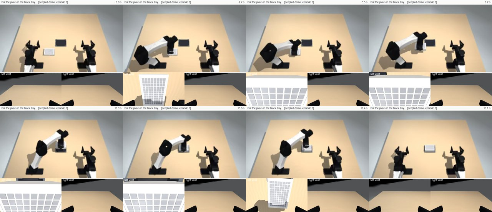

# Scripted demonstrations: plate_to_tray

**Status: built and checked locally. Nothing has been uploaded and no fine-tune has been started.**

50 scripted demonstrations of the `plate_to_tray` chore ("Put the plate on the black tray."), recorded in the YAM
MuJoCo sim under the real physics and saved as one LeRobot v2.1 dataset that passes Dream's local dataset check.
They are for a Dream-1 fine-tune, to find out how much fine-tuning it takes to make a chore the model fails zero-shot
work. Dream-1 has passed `plate_to_tray` 0 times so far (0 of 2 scored takes; a third stopped on a network error).



Short video of episode 0 (the 3 cameras as recorded, played at 2x): [media/demo_episode_000.mp4](media/demo_episode_000.mp4)

## Result

| | |
|---|---|
| Kept episodes | 50, every one scored a success by the bench's own `Tracker` |
| Attempts | 50 (layout seeds 1000 to 1049); 0 dropped |
| Frames | 10,049 at 10 fps (16.75 min of robot time) |
| Episode length | 17.9 to 22.6 s, median 19.9 s |
| Size on disk | 57.52 MB (204 files) |
| Dream's check | `dream.datasets.validate_dataset`: ok, no notes. Full report: `validation_report.json` |

## Can the gripper hold the plate? Yes, with 4 mm to spare on each side

- The fingers open to an inner gap of 93.6 mm, measured on the finger collision meshes at every height where they
  meet the plate. The plate is 85.5 mm across its short side, so a centred hand has 4.1 mm of clearance on each
  side. The plate only fits between the fingers when the gripper is more than 91% open.
- The grip is strong: each finger pushes up to 22 N, and the finger pads have a friction coefficient of 6. The plate weighs 150 g.
- 2 things in this sim make the grasp fail even with the hand in the right place. Both are fixed in the expert:
  1. **A one-step close hooks the plate.** Going from gripper command 1 to 0 in one 50 ms step drives each 71 g
     finger at its full 22 N. It reaches about 1.5 m/s, 3 mm per 2 ms physics step. On seed 1000, the right finger
     sank 2.4 to 4.9 mm into the plate's 4 mm wall at its top edge and hooked it. The plate then stayed on the open
     hand and was carried away. The expert closes and opens over 0.6 s instead.
  2. **A full-force close lets the plate drift.** Commanding 0 saturates both fingers at 22 N. Two equal saturated
     pushes leave the plate free to slide sideways, and it drifted 4.4 mm until one finger reached its open stop,
     so opening the hand no longer cleared the plate. The expert commands 0.6, which grips with about 15 N per
     finger, below the limit. The fingers then act as springs and keep the plate centred (0.2 mm off centre in
     every test).
- With both fixes, 20 of 20 test layouts passed before any recording.
- A hint about the zero-shot failures, not tested further: in the 2 scored `plate_to_tray` takes with logs (seeds
  100 and 102), Dream-1's gripper command went below 0.5 in 59 of 63 and 49 of 63 calls. The plate only fits
  between the fingers above 0.91.

## Files

| Path | What it is |
|---|---|
| `expert.py` | The scripted expert: waypoints plus IK, run through `env.step` |
| `record.py` | Plays the expert on seeded layouts and writes the dataset; keeps successes only |
| `check.py` | Runs Dream's local dataset check against `embodiment.json` and writes `validation_report.json` |
| `media.py` | Makes the contact sheet and the short mp4 from the dataset's own videos |
| `embodiment.json` | The embodiment config the dataset is checked against |
| `attempts.jsonl` | One line per attempt, kept or dropped: seed, stages, success time, where the plate ended, expert settings |
| `validation_report.json` | The output of `validate_dataset` |
| `dataset/plate_to_tray_sim/` | The dataset: one LeRobot v2.1 session folder |
| `media/` | Contact sheet and short mp4 of episode 0 |

## The embodiment config

```json
{
    "state": {"right_arm": [0, 6], "right_gripper": [6, 7], "left_arm": [7, 13], "left_gripper": [13, 14]},
    "action": {"right_arm": [0, 6], "right_gripper": [6, 7], "left_arm": [7, 13], "left_gripper": [13, 14]},
    "video": {
        "overhead": "observation.images.overhead",
        "wrist_l": "observation.images.wrist_l",
        "wrist_r": "observation.images.wrist_r"
    }
}
```

This is exactly `YAM_EMBODIMENT` in `dream_examples/yam_mujoco/dream_control.py`: the parts and camera roles the YAM
example gives the model at run time. `check.py` loads it from `embodiment.json`.

## What is in the dataset

- **Layout:** one session folder in the standard LeRobot v2.1 layout: `meta/info.json`, `meta/episodes.jsonl`,
  `meta/tasks.jsonl`, `meta/episodes_stats.jsonl`, `data/chunk-000/episode_NNNNNN.parquet` and
  `videos/chunk-000/<video key>/episode_NNNNNN.mp4`.
- **Task sentence:** "Put the plate on the black tray." This is the plain wording on the task card, the one the
  scored takes send.
- **Cameras:** overhead (the calibrated station camera), left wrist and right wrist. They are rendered by
  `env.images()` at 640 x 360 and resized to 320 x 176 with the same bilinear resize the run-time client uses
  before it sends a frame. Videos are H.264 at 10 fps, with 1 video frame per data row, a keyframe every 2 frames
  and no B-frames.
- **observation.state:** 14 values, as `env.state()` reports them: right arm 6 joints (rad), right gripper opening
  (0 closed to 1 open), then left arm 6 joints, then left gripper opening.
- **action:** the same 14, as sent to `env.step`: joint targets and gripper commands.
- **Rate: 10 fps, not 20.** Dream's check accepts only 30, 15, 10 or 5 fps (`USABLE_FPS` in
  `shared/datasets/content_checks.py`). Training runs at 30 and resamples the others up to it. The arms still run
  at 20 Hz. Each row is every second control step, taken as it was, with nothing interpolated. At run time the
  client asks for 20 Hz actions (`action_hz: 20`), so the model's output is resampled to 20 Hz there.
- **Start and end:** each episode starts with both arms at home, 1 s after the bench settles. It ends 1 s after
  the bench has scored the success, with the arm back at home. The right arm stays at home throughout.

## The expert

The left hand points straight down and opens fully. It comes down over the plate with the fingers across the
plate's short side, turning the wrist to match the plate's yaw, and closes 22 mm above the plate's underside (the
finger tips stop 12 mm above the table). It lifts the plate 9 cm and carries it over the tray, lowers it until the
underside is 3 mm above the tray floor, opens, rises 8 cm and goes home.

Under the hood: straight lines for the grasp point, with a smooth (minimum jerk) time profile, and inverse
kinematics (damped least squares) on the simulator's own model at every 50 ms step. The joint targets go through
`env.step` exactly as a model's actions would. Nothing is moved by hand: the plate moves only because the fingers
hold it. Each episode varies the speed (0.85 to 1.15 times), the hover height (60 to 80 mm above the plate), the
grasp height (20 to 24 mm) and the carry height (80 to 100 mm), so the 50 demonstrations are not one motion
repeated. The layouts are the bench's own jitter: plate position within 1.2 cm and yaw within 6.9 degrees, tray
position within 8 mm.

### What is not realistic about it

- **It knows exactly where things are.** It reads the true poses of the plate and the tray from the simulator. A
  real robot would have to see them, with errors of millimetres to centimetres. That matters here, because the
  grasp has only 4 mm to spare on each side.
- **It corrects with perfect information.** After the lift it reads where the plate sits in the hand. Over the
  tray it trims the hand so the plate, not the hand, is centred (the trim was under 1 mm). Both readings use the
  simulator's true plate pose.
- **No noise and no surprises.** There is no sensor noise, no calibration error and no slip, and the physics is
  deterministic. Every demonstration is a clean first-try success. The model sees no mistakes and no recoveries,
  so it learns nothing about what to do after a missed grasp.
- **Speeds:** Recorded trajectory speed multipliers ranged from 0.852 to 1.147 times nominal.
- **The grasp:** a top-down pinch on the plate's 2 long walls, with about 15 N per finger. That is plausible for
  a real gripper. The sim's finger pads are far grippier (friction 6) than real pads, but at 15 N the grasp would
  hold the 150 g plate even at a realistic friction of about 0.5. The gripper ramps open and closed over 0.6 s.
  Any real gripper has some speed limit, but it is not measured here.
- **One way to do it.** Every demonstration uses the left hand, the same grasp and the same path shape. A
  fine-tune on these will learn this one style.

## Commands (run, from the repo root)

```bash
~/dream-env/bin/python -m sim_demos.record --keep 50
```

```bash
~/dream-env/bin/python -m sim_demos.check
```

```bash
~/dream-env/bin/python -m sim_demos.media 0
```

`record` took 20.4 min for 50 attempts (about 24 s each, nearly all of it rendering). `check` sends
nothing and needs no key.

## Upload and fine-tune: NOT RUN

**NOT RUN.** None of the lines below has been run. Each one calls the Dream API with the key in
`~/.dreamlabs/credentials`. The fine-tune costs $100 for 500 steps and cannot be cancelled once queued. Whether
and when to run it is the account owner's decision. Replace `<username>` with the account's Dream username.

```python
# NOT RUN. Uses the Dream API key and spends money. Run from the repo root.
import json, time
from dream import datasets, fine_tuning

# 1. NOT RUN. Once per account: register the body the data was recorded on.
datasets.add_embodiment("yam-sim", json.load(open("sim_demos/embodiment.json")))  # -> "<username>/yam-sim"

# 2. NOT RUN. Upload: runs the same checks again, then sends the dataset as one uncompressed zip of about 57.52 MB.
ds = datasets.upload_dataset("sim_demos/dataset", "plate-to-tray-sim-v1", "<username>/yam-sim")
while (ds := datasets.get_dataset(ds.id)).status not in ("processed", "failed"):
    time.sleep(60)
print(ds.status, ds.error)

# 3. NOT RUN. Queue a 500-step fine-tune with a cosine schedule: $100, cannot be cancelled.
job = fine_tuning.create(ds.name, "plate-to-tray-sim", steps=500, lr_schedule="cosine")
while (job := fine_tuning.get(job["id"]))["fine_tuned_model"] is None and job["status"] in ("queued", "running", "succeeded"):
    time.sleep(60)
print(job["status"], job["fine_tuned_model"])  # dream-1-ft:<id>-plate-to-tray-sim
```

The other training settings (learning rate, batch size, and the default half of each batch drawn from Dream's own
data) are left at the service's defaults. To test the fine-tuned model, write its protocol first. Then score it on
seeds 100 to 104, the same layouts as the zero-shot takes, which were never used for these demonstrations. Never
score it on seeds 1000 and up: those are its training layouts.
