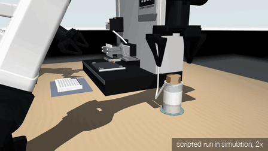

# tending: instrument tending tasks

4 tasks around a simulated plate washer-dispenser set up as a cell seeder: load a plate onto its carrier, unload
it, swirl the cell bottle that feeds it, and load the plate with 1 arm while the other keeps the bottle swirling.
They join the 15 tasks so far in `labbench`, this repo's main package, with its 2 YAM arms, its 3 model cameras
(overhead and both wrists) and its scoring. No liquid is simulated: the swirl is scored as motion of the bottle.



*A scripted run in simulation, sped up 2x. It shows the task can be done; it is not a model.*

## The tasks

<table>
<tr><th>#</th><th>Task</th><th>The robot is told</th><th>Passes when</th><th>Time limit</th></tr>
<tr><td>16</td><td><code>dispenser_plate_in</code></td><td>Put the plate on the dispenser's plate carrier.</td>
<td>The plate sits flat in the carrier pocket with A1 at the back left, let go, both hands out of the carrier's
travel, after a level lift and a level pass over the carrier; a dropped plate fails.</td><td>150 s</td></tr>
<tr><td>17</td><td><code>dispenser_plate_out</code></td><td>Take the plate off the dispenser's plate carrier and put
it on the gray mat.</td><td>The plate lies flat and wholly on the gray mat, let go, with the carrier empty, after a
level lift and a level pass over the mat; a dropped plate fails.</td><td>150 s</td></tr>
<tr><td>18</td><td><code>cell_bottle_swirl</code></td>
<td>Swirl the cell bottle to keep the cells mixed, then put it back.</td>
<td>The bottle was lifted and swirled (3 turns or more, tilt under 20 degrees, within 120 mm of its pick point), then
set back upright on its green spot and let go; a tilt past 30 degrees at any time fails.</td><td>90 s</td></tr>
<tr><td>19</td><td><code>plate_in_with_swirl</code></td>
<td>Load the plate onto the dispenser's plate carrier while your other hand keeps the cell bottle swirling.</td>
<td>Everything task 16 asks, the bottle swirled and home as in task 18, and the bottle swirling for at least half
of the time and half of the plate's travel between the plate leaving the mat and being seated.</td><td>150 s</td></tr>
</table>

Numbers 16 to 19 follow the 15 `labbench` tasks. Each task also has a terse and a precise wording, and the control
sentence "Put the banana in the bowl." (`--variant wrong_object`), which names nothing on the table. Each seed is 1
layout: the instrument and the mat move by up to 15 mm across and 10 mm in depth; the plate sits on the mat up to
12 and 8 mm off its centre, turned up to 0.15 rad (task 17: in the nest, within 1 mm and 0.005 rad); the bottle
moves up to 10 mm each way. Layouts 100 to 104 are kept for scored runs; the first one is registered in
[runs/2026-11-21-tending-zero-shot/PROTOCOL.md](../runs/2026-11-21-tending-zero-shot/PROTOCOL.md).

## Results so far

- **Held-out run: registered, not yet run.** Dream-1, zero-shot, 3 layouts per task (100 to 102), under
  [this protocol](../runs/2026-11-21-tending-zero-shot/PROTOCOL.md), committed before the first take.
- **First look: 0 of 4.** Dream-1 on practice layout 0, 1 completed take per task, no stage reached. The takes can
  be replayed offline: [runs/2026-11-19-tending-first-look](../runs/2026-11-19-tending-first-look/README.md).
- **Scripted reference: passes all 4 tasks** on practice layouts 0 to 4 and on the 3 held-out layouts. It reads
  object positions from the simulator, so it shows the tasks can be done by this robot; it is not a model.

## Run it

From the project folder, with the same Python as `labbench`. None of these calls a model.

```bash
python -m tending stills --task plate_in_with_swirl --seed 0 --out stills/tending   # 3 model cameras, a wide view
python -m tending take --task dispenser_plate_in --seed 0 --policy hold --seconds 5 --out takes   # arms stay home
python -m tending expert --task plate_in_with_swirl --seed 0 --out takes   # scripted expert, summary.json, show.mp4
python -m unittest -v tests.test_tending   # 3 to 6 minutes
TENDING_EXPERT=1 python -m unittest -v tests.test_tending   # adds the scripted expert, 6 to 10 minutes in all
python scripts/tending_run.py --out takes/tending-dry --seeds 0 --policy hold --seconds 3   # the run script, dry
python scripts/tending_replay.py runs/2026-11-19-tending-first-look   # replay the first look's 4 takes
```

- `import tending` adds the 4 tasks to `labbench.tasks.TASKS` in memory (no labbench file changes), so labbench's
  `set_bench` and `run_take` work for them; `take` runs that `run_take`. `expert` scripts both arms from true poses.
- The package has its own fingerprint, `tending.TENDING_ID` (`ba4601eda5dc`), made like labbench's `CODE_ID`
  (`92c256eb309b`, same after the import): sha256 over the name and bytes of each `tending/*.py`, first 12 hex digits.
  `take` and `expert` write it to `summary["versions"]["tending"]`; for other takes, call `tending.stamp(take_dir)`.
- The import also wraps `make_env` in `labbench.take`, in memory, so a build can add the bottle's line (a MuJoCo
  tendon); a build with no tendon gets the same scene as without tending. `stills`, `expert` and `take` aim
  labbench's `show` camera (a 1280 x 720 view for people, never sent to a model) across the table at the instrument.
- `python -m labbench` alone does not see the 4 tasks. Import tending first; a take run this way has no
  `TENDING_ID` until you call `tending.stamp` on its folder:

```bash
python -c "import sys, tending; from labbench.__main__ import main; sys.argv[0] = 'labbench'; main()" take \
  --task dispenser_plate_in --policy hold
```

## Scoring

Frame: metres, +x toward the left arm, +y toward the arm bases, heights above the table top. Control step 0.05 s.

- **Stages and pass:** a stage counts once its test has held 0.5 s without a break, and progress is the share of
  stages reached. A pass is the end state held 1.5 s, with the earlier stages reached first. Task 16:
  `plate_lifted`, `plate_over_carrier`, `plate_seated`. 17: `plate_lifted`, `plate_over_mat`, `plate_on_mat`.
  18: `bottle_lifted`, `bottle_swirled`, `bottle_home`. 19: the 3 stages of 16, then `bottle_swirled`, `bottle_home`.
- **Lifted:** lowest underside corner more than 25 mm above where the underside started, tilt under 10 degrees
  (tipping 1 end up is not a lift). **Over the carrier / mat:** centre within 30 / 40 mm of the target centre on
  each axis, lowest corner more than 15 mm above the nest floor / table, tilt under 10 degrees.
- **Seated:** centre within 2.5 mm of the nest centre on each axis (2 mm clearance plus 0.5 mm), every underside
  corner within 1 mm of the nest floor, tilt at most 2 degrees, turned at most 3 degrees (a half turn fails),
  released. Released, or let go: no robot contact within 1 mm, and the plate moving under 0.03 m/s.
- **Hands clear (16, 19):** neither grasp point nor the centre of any of the 192 fingertip pad geoms is in the
  carrier's travel box: within 90.9 mm of the nest centre across, from the housing face (125 mm behind the nest
  centre) to the deck front (69.75 mm in front of it), 54 to 105 mm above the table.
- **On the mat (17):** every underside corner inside the 190 x 140 mm mat and within 2 mm of the table top, tilt
  at most 3 degrees, released; the carrier is empty when the plate's centre is not over its slab (10 mm margin).
- **Held (bottle):** underside more than 10 mm above its start and no contact within 1 mm with anything but the
  robot, so a bottle slid on a surface is never held. `bottle_lifted` also needs tilt under 20 degrees.
- **Swirled:** in 1 hold, at least 0.60 m of horizontal path and at least 3 turns about a running centre (the
  bottle's position averaged with a 1 s time constant). A hold that tilts past 20 degrees or goes more than 120 mm
  from its pick point counts for nothing. A step's turn counts only if under 90 degrees with the bottle over 4 mm
  from the centre; a step longer than its last speed, gravity and 5 mm allow (a scripted jump) adds nothing.
  Latched once reached. Turns are counted because path alone cannot tell a swirl from a straight shake.
- **Home:** within 20 mm of the spot, underside within 5 mm of the table top, tilt under 5 degrees, released.
- **Together (19):**
  - Window: opens when the plate's lowest corner first rises 10 mm above its start, closes when the plate is
    seated. Every step inside counts, with no speed threshold, so the whole way from mat to nest is judged.
  - Swirling step: in an unspoiled hold the bottle moves at least 1 mm horizontally and turns at least 0.04 rad
    (0.13 turns a second) about its running centre, the same way as its turns so far: a straight shake never swirls.
  - Time rule: swirling on at least half of the window's steps, so a plate rushed to the nest during a swirl and
    then left hanging with the bottle resting fails.
  - Travel rule: swirling over at least half of the plate's travel in the window (each step weighted by how far
    the plate moved), so the arms cannot take turns: a carry with the bottle resting adds travel, however slow.
  - At least 0.10 m of plate travel in the window, so it holds a real carry (the scripted expert's is 0.38 m).
- **Drop:** a plate that comes to rest untouched with its lowest corner more than 20 mm below where it was on the last
  step the robot touched it is dropped: the take cannot pass, and touching it again does not clear it (stages still
  count). Script moves (a pose pinned each step, an impossible jump with no grasp point within 0.12 m) are not falls.
- **Spill:** bottle tilt above 30 degrees at any time, held or not, is final. There is no bottle drop rule.

## What the checks cover

`tests/test_tending.py` has 23 tests, with no model and no network; 2 run only with `TENDING_EXPERT=1`.

- **Oracle and stamps:** on seeds 0, 1 and 2 each task starts at rest and the oracle (a script that places the
  labware, arms home) passes with full progress; `CODE_ID` is still `92c256eb309b`; 2 s hold takes carry `TENDING_ID`.
- **Traps:** 30 scripted look-alike failures (6, 7, 8 and 9 per task), each on seeds 0 and 1; none may pass. 16: the
  plate turned half a turn in the nest; 1 end on the corner guides. 17: the plate half off the mat; the plate tipped
  out of the nest and pushed to the mat, never lifted. 18: the bottle shaken 5 cm each way in a straight line (1.26
  m of path, 0 turns on seed 0); the bottle slid in circles on the instrument deck. 19: the bottle swirled first,
  then the plate loaded; the plate carried during a swirl, then left over the nest 10 s with the bottle resting.
- **Each rule does its part:** 7 of the 9 traps of task 19 end with the plate seated and the bottle swirled and
  home, so the together rule alone fails them; the oracle passes it (seeds 0 and 1). The deck-slide trap of task
  18 passes once the support test is switched off, so that test is what fails it (seed 0).
- **Drop rule** (tasks 16 and 17, seeds 0 and 1): a plate let go 15 mm above its place passes, 30 mm fails; a
  plate dropped from 5 cm, then touched by the open fingertips, with the arm sent home, still fails. With the
  scripted expert (seed 0), opening the gripper 10 mm above the place passes and 30 mm fails.
- **Keep-out rule** (task 16, seeds 0 and 1): a seated plate does not pass with the left grasp point in the travel
  box, nor with the grasp point just outside and fingertip pads inside; both pass once the hand goes home.
- **Together rule with the real arms** (seed 0): the right arm swirling only until the left arm's carry starts,
  with the left arm starting 8 s late and carrying and lowering 4 times slower than the expert, ends seated,
  swirled and home, and fails. The expert carrying and lowering 5 times slower, the bottle swirling all along, passes.
- **The drawn parts add no collision and no force:** on all 4 tasks the instrument has exactly its 14 colliding
  geoms and the bottle only its wall and cap (0.16 kg); 300 control steps of the right arm gripping, lifting and
  swirling the bottle give the same joint state with and without the bottle's line. The drawn parts hide at most a
  tenth of the carrier, plate and bottle in the model cameras that see them (task 16, seeds 0 to 4).
- **Scripted expert** (`TENDING_EXPERT=1`, seeds 0 to 4): each task passes on at least 4 of 5 seeds; passing swirl
  runs need 0.60 m of path and no robot contact deeper than 2 mm into the bottle; task 19 needs both arms moving
  together for 3 s and the together rule. On seed 0 of tasks 16, 17 and 19, every drawn part of the instrument
  body stays at least 10 mm from the arms and the plate (the clamp block and the line are not in this check).

## The instrument

1 static body with its carrier out at the load position. Drawn on it: a peristaltic pump with a tube cassette
(8 tubes over a roller cage), a dispense head with 8 tips over the carrier's path, a wash manifold over its
trough, a keypad with a display, and the carrier with 4 corner guides, a clamp block and a rail. The cell bottle
(clear, pink medium, orange cap) stands on a green spot on the right arm's side; its line to the pump is a MuJoCo
tendon. Only the deck, housing, slot walls, carrier slab and corner guides collide; the rest is drawn only.

| Part | Public value | In the simulation | Source |
|---|---|---|---|
| Plate footprint | 127.76 x 85.48 mm | 127.8 x 85.5 mm | S1 |
| Plate height | 14.35 mm | 14.4 mm, 45 g, 1 solid box | S2 |
| Well grid | 8 x 12 at 9.0 mm pitch, A1 marked | drawn wells at 9 mm; a blue A1 square and row A stripe | S4 |
| Orientation | A1 at the left rear, facing it | A1 at the plate's (+x, -y) corner: left rear seen from the arms | M |
| Overall size | 42 x 32 x 46 cm (W x D x H) | 0.42 x 0.32 x 0.46 m | M |
| Room over the plate | plate clearance 16.52 mm | slot ceiling 90.9 mm (60 + 14.4 + 16.5 mm) | M; slot use assumed |
| Pocket clearance | not published | 2 mm per side (pocket 131.8 x 89.5 mm) | assumed |
| Nest height | not published | deck top 54 mm, nest floor 60 mm above the table | assumed |
| Housing face | not published | 125 mm behind the nest centre | assumed |
| Carrier travel | right and left on a rail | static; travel assumed toward the back, into a slot | M p. 22 |
| Cell bottle | about 1 L, orange cap | labbench's 125 mL bottle, 50 x 100 mm, 0.16 kg, fits the gripper | M photos |
| Gripper gap | none | 93.6 mm inside the open fingers | `sim_demos/NOTES.md` |

Sources:
- S1: ANSI/SLAS 1-2004, Footprint Dimensions.
  https://www.slas.org/SLAS/assets/File/public/standards/ANSI_SLAS_1-2004_FootprintDimensions.pdf
- S2: ANSI/SLAS 2-2004, Height Dimensions.
  https://slas.org/SLAS/assets/File/public/standards/ANSI_SLAS_2-2004_HeightDimensions.pdf
- S4: ANSI/SLAS 4-2004, Well Positions.
  https://www.slas.org/SLAS/assets/File/public/standards/ANSI_SLAS_4-2004_WellPositions.pdf
- M: BioTek (now Agilent) EL406 Operator's Manual, PN 7181000 Rev B, April 2009, a public copy:
  https://med.stanford.edu/content/dam/sm/htbc/documents/eq/EL406-Operator-s-Manual-7181000-Rev-B.pdf

## Limits

- The scripted expert reads true poses from the simulator: it shows a task can be done, not how hard it is.
- No liquid is simulated. The swirl is scored as motion only; the score says nothing about the cells.
- The carrier never moves and there is no interlock. The keep-out box stands in for one, and it checks only the
  grasp points and the fingertip pads. Its travel toward the back, into a slot, is assumed; the manual's carrier
  slides right and left. The clamp block exerts no force: the plate stays in by its guides and gravity.
- The 2 plate tasks do not score the bottle: a model that knocks it over while moving the plate still passes.
- In tasks 16, 18 and 19 the plate starts out of both wrist cameras' view; only the overhead camera sees it then.
- The thresholds were set for this robot and this bottle and have not yet been tried against many model runs.
- Seed variation is small (up to 15 mm and 0.15 rad). Passing on every practice layout (any seed but 100 to 104)
  shows a task can be done, not that a policy is robust.
- A likeness, not a copy: sizes read off the manual's photos are estimates; parts it gives no number for are assumed.
- Which hand does what is not scored. Task 19's together rule is judged only until the plate is first seated.
- The swirl is measured at the centre of the bottle's base: rocking it about a still base is not a swirl.
- The swirl limits are wide on purpose: a tilt up to 20 degrees and circles up to 120 mm from where each hold began
  count, so a bottle picked up again elsewhere can be swirled there. It must still end on its spot.
